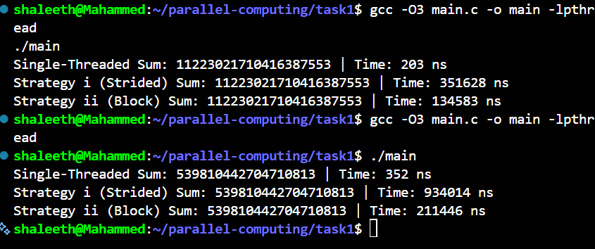

# Task I — Multithreaded Array Summation

**Parallel Computing | C | POSIX Threads | Linux**

## 1. Overview

This task investigates the performance of sequential and multithreaded computation by calculating the sum of a randomly generated array of 64-bit unsigned integers.

The same problem is solved using three different approaches:

1. Single-threaded summation
2. Four-thread strided partitioning
3. Four-thread block partitioning

The objective is to understand how workload distribution, memory access patterns, and thread management overhead affect execution time.

This implementation is part of a larger parallel computing project exploring CPU parallelism, synchronization primitives, lock-free data structures, and GPU computation.

## 2. Problem Statement

Given an array `A` containing `N` 64-bit unsigned integers, compute its total sum:

\[
S = \sum_{i=0}^{N-1} A[i]
\]

The sum must be computed using a conventional single-threaded approach and two parallel approaches employing four worker threads.

The implementation compares the resulting sums and measures the execution time of each approach.

### Requirements

- Use 64-bit unsigned integers.
- Implement a single-threaded baseline.
- Implement two four-thread parallel strategies.
- Ensure that all strategies calculate the same sum for the same input.
- Measure and compare execution times.
- Run the program in a Linux environment.

## 3. Implementation

### 3.1 Single-Threaded Summation

A single thread traverses the entire array, accumulating each element into a running sum.

**Time complexity:** `O(N)`

This approach serves as the baseline against which the parallel implementations are compared.

Advantages include straightforward implementation and the absence of thread creation and joining overhead.

### 3.2 Strategy I — Strided Partitioning

The array is distributed among four worker threads according to the remainder of each index when divided by four.

For thread `t`, where `t` ranges from `0` to `3`, the assigned indices satisfy:

\[
i \bmod 4 = t
\]

Each thread calculates a partial sum over its assigned elements. The partial sums are subsequently combined to obtain the final result.

Example distribution:

| Thread | Array indices |
|---|---|
| Thread 0 | 0, 4, 8, 12, ... |
| Thread 1 | 1, 5, 9, 13, ... |
| Thread 2 | 2, 6, 10, 14, ... |
| Thread 3 | 3, 7, 11, 15, ... |

Each thread processes approximately one-fourth of the array.

**Total work:** `O(N)`

**Idealized parallel computation time:** `O(N/4)`, excluding overhead and assuming adequate parallel hardware.

### 3.3 Strategy II — Block Partitioning

The array is divided into four contiguous blocks. Each worker thread processes the elements within its assigned range.

For thread `t`, the block boundaries are:

\[
\text{start}_t = \left\lfloor \frac{tN}{4} \right\rfloor
\]

\[
\text{end}_t = \left\lfloor \frac{(t+1)N}{4} \right\rfloor
\]

The thread processes indices in the half-open interval:

\[
[\text{start}_t,\text{end}_t)
\]

The partial sums are combined after the worker threads finish.

This approach provides contiguous memory access, which may improve cache locality and hardware prefetching.

**Total work:** `O(N)`

**Idealized parallel computation time:** `O(N/4)`, excluding overhead and assuming adequate parallel hardware.

## 4. Experimental Setup

The implementation was compiled using GCC with optimization enabled.

| Parameter | Configuration |
|---|---|
| Programming language | C |
| Compiler | GCC |
| Optimization flag | `-O3` |
| Threading API | POSIX threads |
| Number of worker threads | 4 |
| Integer type | 64-bit unsigned integer |
| Execution environment | Linux |

The recorded measurements below come from two executions of the program. The array was randomly generated, so the input and resulting sum differed between runs.

## 5. Benchmark Results

The following screenshot shows the actual terminal output produced by the implementation.



### Recorded Measurements

| Run | Strategy | Computed Sum | Time (ns) |
|---|---|---:|---:|
| 1 | Single-threaded | 11223021710416387553 | 203 |
| 1 | Strided partitioning | 11223021710416387553 | 351628 |
| 1 | Block partitioning | 11223021710416387553 | 134583 |
| 2 | Single-threaded | 539810442704710813 | 352 |
| 2 | Strided partitioning | 539810442704710813 | 934014 |
| 2 | Block partitioning | 539810442704710813 | 211446 |

**Measurement note:** These values are the timings reported by the current implementation. They are preliminary measurements, not statistically validated benchmarks.

The sequential times are exceptionally short for a substantial array. Timer resolution, compiler optimization, workload size, and the exact timing boundaries may affect these measurements. Further testing is needed before drawing firm performance conclusions.

## 6. Results and Analysis

### 6.1 Correctness

Within each execution, all three approaches report the same computed sum.

This provides an initial consistency check between the sequential and parallel implementations for each generated input.

### 6.2 Strided vs. Block Partitioning

Block partitioning was faster than strided partitioning in both recorded runs.

| Run | Strided time | Block time | Observed comparison |
|---|---:|---:|---|
| 1 | 351628 ns | 134583 ns | Block was faster |
| 2 | 934014 ns | 211446 ns | Block was faster |

One possible explanation is the difference in memory access patterns.

Block partitioning traverses contiguous memory locations, whereas strided partitioning skips between locations assigned to other threads. Depending on the workload and hardware, contiguous access can make more effective use of caches and prefetching.

These observations apply to the recorded executions only. Repeated experiments with identical input data are needed to establish a reliable comparison.

### 6.3 Sequential vs. Parallel Execution

The recorded sequential execution times are much smaller than the parallel execution times.

Possible reasons include:

- Thread creation and joining overhead.
- An input size that is too small to benefit from parallel execution.
- Timing boundaries that include thread management in the parallel cases.
- Timer resolution and measurement noise.
- Compiler optimization effects.

Parallel execution does not automatically make every workload faster. The benefits depend on the amount of computation, the available hardware, and the overhead introduced by parallelization.

### 6.4 Reproducibility

Because the array is randomly generated, the sum changes between executions.

For a more rigorous experiment, the same array should be used for all three strategies. A fixed random seed or a saved input array would make comparisons more reproducible.

## 7. Build and Run

### Prerequisites

- Linux or a compatible Linux environment such as WSL.
- GCC compiler.
- POSIX threads support.

### Compile

Run the following command from the `task1` directory:

```bash
gcc -O3 main.c -o main -pthread
```

### Execute

```bash
./main
```

The program prints the computed sum and execution time for the sequential implementation and both parallel strategies.

The exact measurements depend on the input, compiler, hardware, and runtime environment.

## 8. Performance Measurement Considerations

The current measurements provide an initial comparison, but a more rigorous benchmark should include:

- Testing multiple array sizes.
- Running every strategy on the same generated array.
- Repeating each measurement many times.
- Reporting the median and variation across runs.
- Using a monotonic high-resolution clock, such as `clock_gettime()` with `CLOCK_MONOTONIC`.
- Separating thread creation and joining overhead from computation time where appropriate.
- Recording the CPU model, compiler version, and system configuration.
- Checking that compiler optimization does not eliminate or distort the measured work.

For sufficiently large arrays, the experiment can also investigate speedup:

\[
\text{Speedup} =
\frac{T_{\text{sequential}}}
{T_{\text{parallel}}}
\]

A speedup greater than one indicates that the measured parallel execution was faster than the sequential baseline under the same measurement conditions.


## 9. Project Context

This task is the first component of a broader parallel computing project.

Subsequent tasks will investigate:

- **Task II:** A lock-free single-producer single-consumer ring buffer using atomic operations.
- **Task III:** A GPU-accelerated forest-fire simulation using compute shaders.

---

**Status:** Task I implementation completed; benchmark methodology and performance analysis can be refined further.