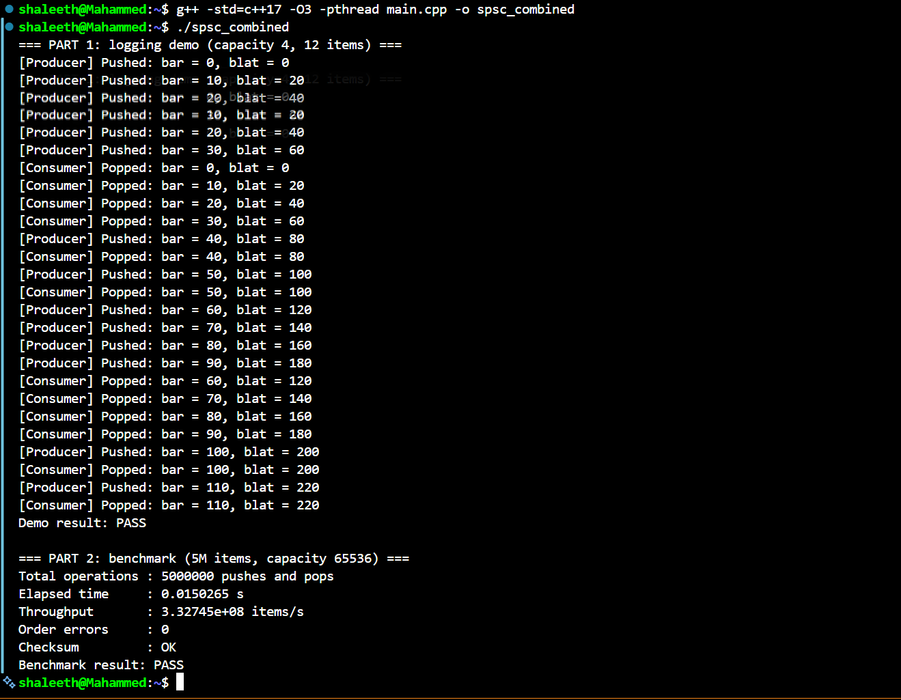

# Task II — Lock-Free SPSC Ring Buffer

**Parallel Computing | C++ | Atomics | Concurrency**

## 1. Overview

This task implements a fixed-capacity, single-producer single-consumer (SPSC) ring buffer in C++.

A ring buffer is a bounded data structure that stores elements in a circular array. The producer inserts elements, while the consumer retrieves them. Once the producer reaches the end of the array, it wraps around to the beginning.

The implementation uses atomic cursors to coordinate access between the producer and consumer without using mutexes in the buffer operations.

The project explores concurrency, memory ordering, cache alignment, RAII, and performance measurement.

## 2. Problem Statement

Implement a fixed-capacity SPSC ring buffer whose capacity is a power of two.

The buffer must support:

- One producer inserting elements.
- One consumer removing elements.
- Fixed-capacity circular storage.
- Atomic coordination between producer and consumer.
- Handling full and empty states.
- Correct transfer of data between threads.
- Performance measurement under concurrent execution.

The implementation uses C++ and is designed to run in a Linux environment.

## 3. Design and Implementation

### 3.1 Circular Storage

The buffer allocates a backing array with a fixed capacity.

For a capacity that is a power of two, an index can be calculated using a bit mask:

```cpp
cursor & (capacity - 1)
```

This avoids using the modulo operator for index wrapping.

The implementation maintains logical cursors that advance as elements are produced and consumed.

### 3.2 Producer and Consumer Cursors

The implementation maintains two atomic cursors:

- `pushCursor_`: Tracks the producer's progress.
- `popCursor_`: Tracks the consumer's progress.

It also caches the opposite cursor locally to reduce repeated atomic loads.

The producer checks whether the buffer is full before reserving a slot. The consumer checks whether the buffer is empty before accessing an element.

### 3.3 Memory Ordering

The implementation uses acquire and release memory-order operations.

- Acquire loads are used when refreshing the cached cursor from the other thread.
- Release stores publish the producer's progress and the consumer's progress.

These operations are intended to coordinate access to the buffer's elements without a mutex.

Correctness depends on the complete synchronization protocol, not simply on the use of atomic variables.

### 3.4 Cache Alignment

The implementation aligns important cursor variables using `alignas` and a hardware interference size.

The goal is to reduce false sharing, which can occur when independently updated variables occupy the same CPU cache line.

The fallback alignment value in the current implementation is 64 bytes.

### 3.5 RAII Access Handles

The implementation defines two nested handle types:

- `pusher_t`: Provides access to a producer slot.
- `popper_t`: Provides access to a consumer slot.

These handles use object lifetime to perform cursor updates and, for the consumer handle, element destruction.

This design reduces the need for callers to manually perform completion steps. The handle ownership and release semantics must nevertheless be used carefully to avoid losing or processing an element more than once.

## 4. Demonstration

The program contains a producer-consumer demonstration using a small ring buffer.

The producer writes five `Foo` objects, each containing two integer fields:

```cpp
struct Foo {
    int bar;
    int blat;
};
```

The consumer reads the produced objects and prints their values.

The producer and consumer run in separate threads and coordinate through the ring buffer.

## 5. Performance Benchmark

The program also includes a throughput benchmark using a ring buffer with a capacity of 65,536 elements.

The benchmark configures:

| Parameter | Value |
|---|---|
| Buffer capacity | 65,536 |
| Producer threads | 1 |
| Consumer threads | 1 |
| Producer pushes | 5,000,000 |
| Consumer pops | 5,000,000 |
| Language | C++ |
| Timing API | `std::chrono` |

The producer writes each element's `bar` and `blat` fields. The consumer reads `bar` and counts the consumed elements.

The program measures elapsed time and calculates the reported throughput.

### Benchmark output



The screenshot above should contain the actual terminal output from running the implementation.

### Interpreting the results

The benchmark provides an initial measurement of the implementation's producer-consumer throughput.

Throughput is calculated in the program as:

\[
\text{Throughput} =
\frac{\text{TOTAL\_OPS}}{\text{Elapsed Time}}
\]

Here, `TOTAL_OPS` is 5,000,000. The output labels this as operations per second, while the producer performs five million pushes and the consumer performs five million pops.

Consequently, the reported number represents the rate of completed producer iterations (and corresponding consumer iterations), not the combined count of ten million individual push and pop calls.

The measured performance depends on the CPU, compiler, optimization settings, scheduling, and runtime environment.

A meaningful performance evaluation should also verify that every produced element is consumed exactly once and that the benchmark is not affected by correctness issues.

## 6. Build and Run

### Prerequisites

- Linux or Windows Subsystem for Linux (WSL).
- A C++ compiler supporting C++17 or later.
- Standard C++ threading and atomic support.

### Compile

From the `task2` directory, run:

```bash
g++ -std=c++17 -O3 -pthread main.cpp -o main
```

### Execute

```bash
./main
```

The program runs the demonstration followed by the throughput benchmark.

The exact elapsed time and throughput depend on the execution environment.

## 7. Correctness and Validation

The following checks should be performed before considering the implementation fully validated:

- Confirm that the buffer rejects capacities that are zero or not powers of two.
- Verify FIFO ordering for produced and consumed elements.
- Confirm that every produced element is consumed exactly once.
- Test repeated wraparound of the circular buffer.
- Test full and empty conditions.
- Test with trivial and non-trivial payload types if the template is intended to support both.
- Verify that access handles cannot be copied in a way that causes duplicate commits or destruction.
- Review handle release semantics.
- Verify the acquire/release synchronization protocol.
- Confirm that destruction occurs only after producer and consumer threads have stopped.

These tests are particularly important because concurrency errors can be intermittent and may not appear in a single successful run.

## 8. Implementation Considerations

### Single-producer, single-consumer constraint

This design targets exactly one producer and one consumer. It should not be treated as a multi-producer or multi-consumer queue without additional synchronization and a redesigned algorithm.

### Lock-free guarantees

The implementation uses atomic operations and does not use mutexes in its buffer operations. However, a fully verified lock-free claim requires checking the atomic guarantees and the algorithm's progress properties on the target platform.

The use of atomics alone does not establish that every operation is lock-free.

## 9. Project Context

This task follows Task I, which compares sequential and multithreaded array summation.

The next task will explore GPU-based forest-fire simulation using compute shaders.

---

**Status:** Implementation and benchmark available; correctness and performance validation remain important next steps.